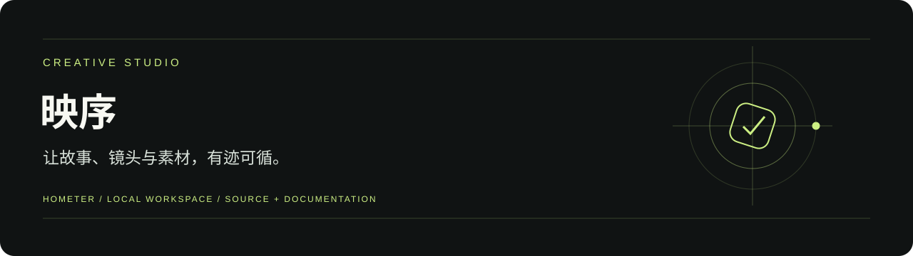
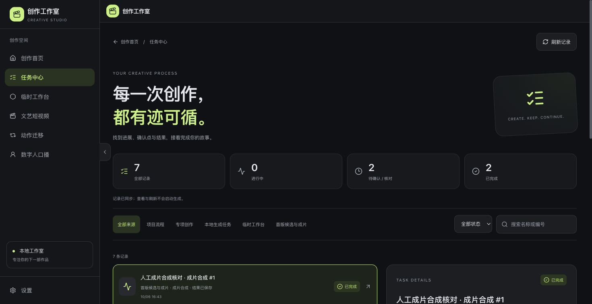

<div align="center">



# 映序｜AIGC 视频创作与任务编排 Agent

**让故事、镜头与素材，有迹可循。**

[快速开始](#快速开始) · [配置说明](docs/配置说明.md) · [文档导航](docs/README.md) · [项目状态](docs/项目状态.md)

</div>

## 项目介绍

面向独立短片、短剧创作者，解决素材分散、角色与场景版本不一致、上游修改导致下游返工等问题，构建从脚本、资产、分镜到生成、审核与导出的创作流程。

[完整项目介绍与核心职责](docs/项目介绍.md)

## 历史界面预览



实际任务中心界面，来自 2026-10-06 本地验收。成片与任务为人工演练资料，不能视为模型生成效果。

## 核心功能

- 创作准备：项目目标、剧本与分镜候选，以及人工选用和共创草稿。
- 素材与修改：角色、场景、道具和媒体版本，指定引用、比较、修改、回退与依赖影响提示。
- 生成准备：模型参数、素材声明、费用估算和人工确认；后台任务状态持久化与结果定位。
- 成片与恢复：本机视频合成、任务中心、文字快照导出及同项目受控恢复。

## 快速开始

准备 Python 3.12、Node.js 22、FFmpeg / ffprobe；macOS / Linux。 下列命令适用于 macOS / Linux。先安装依赖：

```bash
git clone https://github.com/Hometer/ai-creation-studio.git
cd ai-creation-studio
APP="docs/AI视频/xiaoyunque-main/xiaoyunque/xiaoyunque"
python3.12 -m venv "$APP/backend/.venv"
"$APP/backend/.venv/bin/python" -m pip install -r "$APP/backend/requirements.txt"
npm --prefix "$APP/frontend" ci
python3.12 scripts/project.py doctor
```

启动服务：

```bash
# 终端一，从仓库根目录运行
python3.12 scripts/project.py backend
# 终端二，从仓库根目录运行
python3.12 scripts/project.py frontend
```

打开 <http://127.0.0.1:3000>；API 文档在 <http://127.0.0.1:8000/docs>。按 `Control+C` 停止对应服务。

## 配置说明

启动后在「设置」页配置自己的模型服务。安全配置保存在主应用后端本地，`config.yaml` 和秘密配置均被 Git 忽略。模型 Key 只供后端使用。默认后端 8000，前端代理可通过 `BACKEND_API_URL` 调整；真实生成需自行确认素材权利、费用与预算。

详细参数、数据位置和工程检查见 [配置说明](docs/配置说明.md)。仓库不包含本机密钥、业务数据、依赖目录或运行缓存。

## 当前范围

本地单用户 MVP。首版 F01—F08 有工程覆盖，真实故事到成片、平台认证、实际账单、人物一致性、真机和整体业务验收仍待完成。历史截图中的成片使用人工样例；旧收费入口受费用闸门限制。

以 [项目状态](docs/项目状态.md)、当前 PRD 与对应验收记录为准。历史测试与截图标明其范围，本次上传不新增产品验收结论。

## 文档与代码

主要代码保留在 `docs/AI视频/xiaoyunque-main/xiaoyunque/xiaoyunque/`，包含 `backend/` 和 `frontend/`。根目录 `scripts/project.py` 提供统一入口；本次保留该路径以兼容既有运行与验收脚本。

[文档导航](docs/README.md) · [当前需求](docs/PRD/PRD.md) · [配置与检查](docs/配置说明.md)

<details>
<summary>展开开发手册、需求与验收记录</summary>

- [需求与 PRD](docs/PRD/)
- [开发手册与操作说明](docs/手册/)
- [技术适配与阶段开发文档](docs/阶段文档/)
- [验收记录与实际界面证据](docs/evidence/)
- [历史首页与分期开发记录](docs/历史/开发记录.md)
- [本次仓库整理记录](docs/仓库整理记录.md)

</details>

## 许可与来源

保留原项目 [LICENSE](LICENSE) 与作者署名。项目由 AI 产品开发工具包起步；历史规则与必要文档保留，新增整理以实际实现为准。
