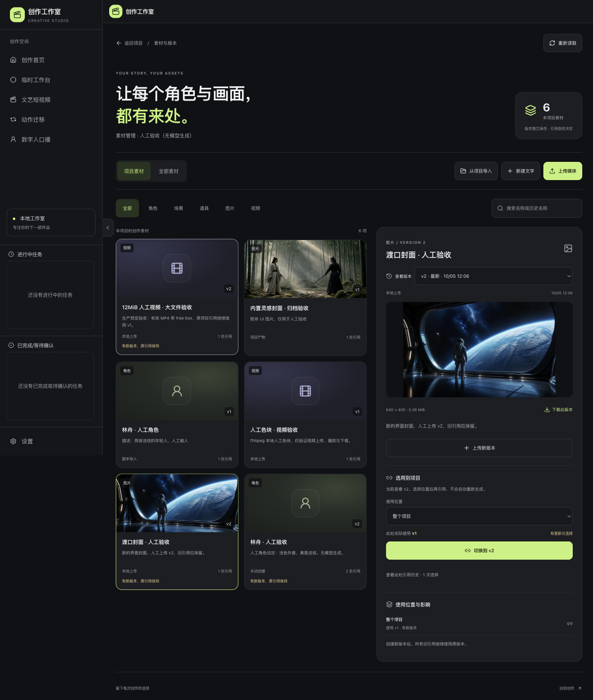
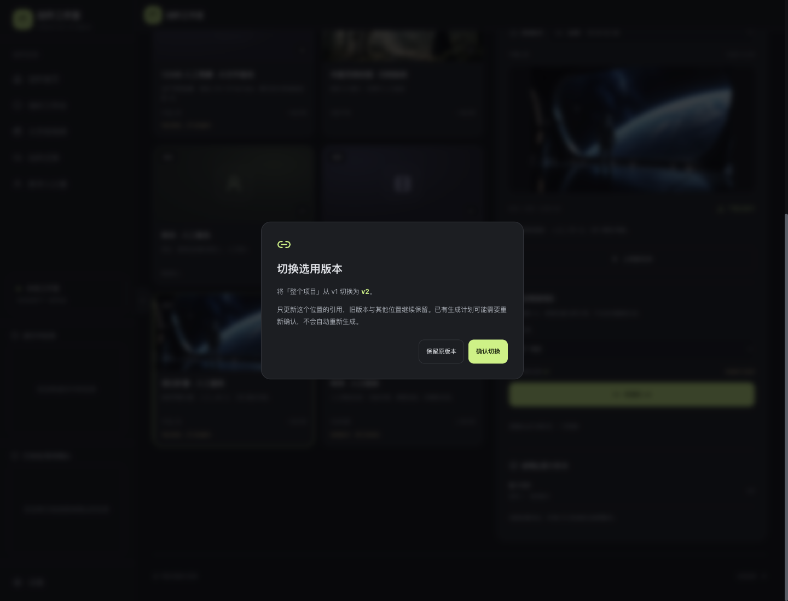
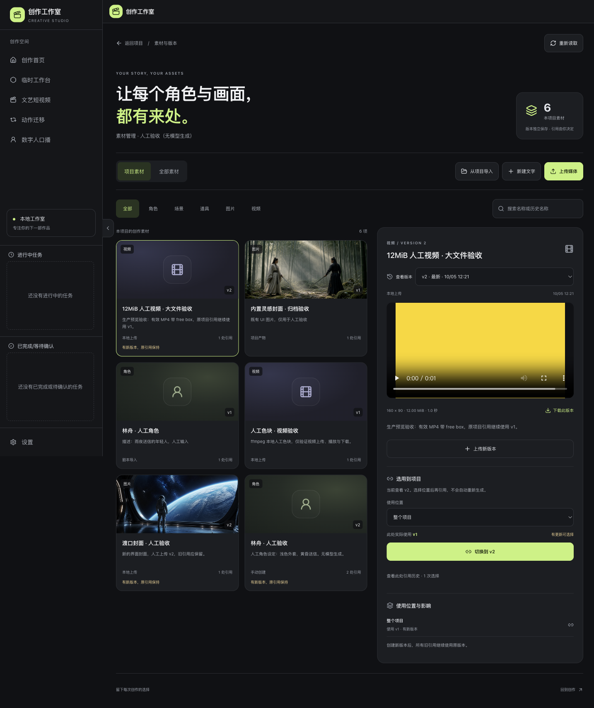
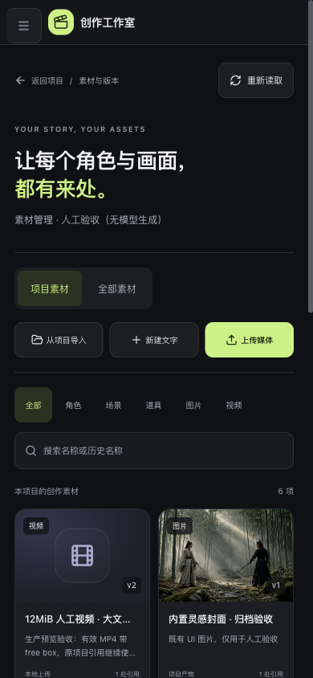
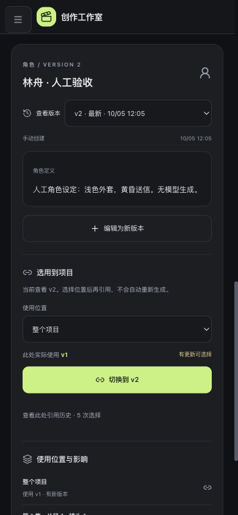
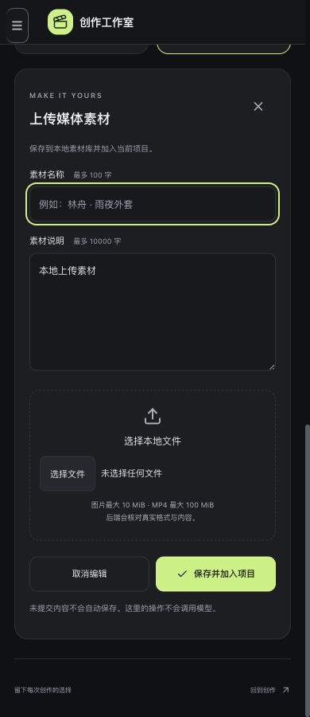

# 项目素材与版本管理验收报告

2026-10-05。基线 fd97ff5；按产品经理“先文档、开发、验证后提交”实施，本机单用户工程交付，模型接入继续后置。

## 可直接打开

[创作首页](http://127.0.0.1:3000/) · [素材管理人工验收项目](http://127.0.0.1:3000/projects/c78e11b1c484494e9faca397d8185a34/assets) · [素材复用人工验收项目](http://127.0.0.1:3000/projects/edbbbd83281441849f7827d6cecca6cc/assets)

本轮保留后端 8000 与前端生产预览 3000。若地址打不开，在项目根目录的两个终端分别运行 `python3.12 scripts/project.py backend` 和 `python3.12 scripts/project.py frontend`，再打开首页。无需配置模型 Key。文档先形成于 `docs/阶段文档/`，实现位于现有 frontend 和 backend。

新增两个验收项目、6 份素材、9 个版本与 8 处引用，均为人工输入、既有 UI 封面或本地 ffmpeg 色块；名称明确标注人工，不表示真实模型输出。本地业务数据与验收夹具不进入 Git，原三个用户项目保留。下列素材操作不发送模型请求、不产生生成费用。

## 照着点核对

1. 打开创作首页，在“素材管理 · 人工验收（无模型生成）”项目卡点击“素材与版本”。应进入深色素材页，看到项目名称、项目／全部素材、分类、搜索及三项创建入口。项目工作台顶栏也能进入此页。
2. 点击“林舟 · 人工验收”。“查看版本”为 v2，而“此处实际使用”为 v1；展开“查看此处引用历史”能看到此前明确切换与回退。切换使用位置到“第 1 集 · 片段 1 · 镜头 1”，也应仍用 v1。另一个人工验收项目同样复用了此素材的 v1。
3. 点击“切换到 v2”。对话框展示 v1 到 v2 和影响；先点“保留原版本”或按 Escape，引用保持。需要体验切换时点“确认切换”，历史会新增一次选择；再选 v1 并确认，可回退。其他位置不自动变化，也不重新生成。
4. 点击“渡口封面 · 人工验收”，下拉选择 v1 与 v2，应看到不同图片。可“下载此版本”。点击“12MiB 人工视频 · 大文件验收”，应看到本地黄色色块 MP4、播放控件、12.00 MiB 和 1.0 秒，当前 v2 的项目引用仍为 v1。该视频有有效 free box，用于大文件传输验证。
5. 点击“新建文字”，填写名称和定义，保存。随后“编辑为新版本”，改一处文字并保存；应出现新版本，原引用保持。也可“上传媒体”选择有权使用的非敏感 PNG 或 MP4，填写名称和说明并保存；图片最大 10 MiB、视频最大 100 MiB。错误时输入保留，可更换文件继续。
6. 点击“从项目导入”，选择已有角色或已选图片，保存。相同项目来源和内容重复导入不会增加版本。搜索可匹配历史名称，分类只过滤列表。切到“全部素材”可以选择未属于当前项目的素材，并显式引用加入项目。
7. 刷新页面，仍能看到保存版本和实际引用。窄屏选择素材后详情应定位到导航下方，上传表单、分类搜索和版本确认可操作；左上角按钮打开／关闭菜单。未保存编辑离开前有提醒，选择留下会保留输入。

## 已实际核对的结果

| 检查 | 结果 |
| --- | --- |
| 自动回归 | 后端 551/551（新增 29，原 522 保留）；前端 76/76（新增 27，原 49 保留） |
| 工程检查 | 类型检查通过，Lint 0 错误／0 警告，生产构建通过；最后 CSS 调整后再次检查类型／Lint／构建 |
| 真实页面操作 | 新建／追加文字，PNG／MP4 上传，媒体追加，项目和镜头引用，确认升级／回退，跨项目复用，重复导入无新增版本均通过 |
| 恢复和错误 | 并发引用产生冲突提示并重读；无效图片保留名称、说明和文件；未保存取消离开保留输入；断网不伪装空库，恢复后可重新读取；无效版本 URL 明确提示不存在 |
| 代理及媒体 | 修复默认 10 MiB 截断；有效 12,584,936 字节 MP4 经开发和生产同源代理完整上传，生产追加 v2 后原引用仍为 v1；视频可播放，实际下载与原文件 SHA256 相同 |
| 四宽度检查 | 390／768／1280／1440 下列表、详情、上传表单、确认对话框共 16 项通过；最后页头视觉调整另复查四种宽度，无横向溢出，搜索框可输入；手机菜单与键盘 Escape／焦点返回已检查 |
| 真实服务重启 | 两轮实际停止并重启后端；最终 6 份素材、9 个版本、8 处引用、所有归档文件和五个会话保持一致，原三个用户会话哈希不变；页面可重新读取 |
| 密钥排除 | 仓库、提交范围和生产 JavaScript 密钥特征无命中；用户数据、配置秘密、临时夹具与构建产物未纳入提交 |

后端有两条既有 pytest 配置及 SDK 弃用警告；未通过删测试或隐藏失败获得结果。宽度检查使用 Chromium 模拟，不代替真机反馈。真实模型效果、账号隔离、留存与整体 PRD／上线验收仍保持待验。

## 生产页面截图

六张截图逐张查看，媒体为人工验收内容。

## 阶段闸门是否表

| # | 检查项 | 是／否／待验 | 证据 |
| --- | --- | --- | --- |
| 1 | 本轮范围内功能已实现，没有提前做后续阶段 | 是 | 素材与版本管理；无收费、模型执行、账号或部署扩展 |
| 2 | mock 自动化测试已运行且通过 | 是 | 后端 551/551，前端 76/76，合计 627/627 |
| 3 | 真实模型冒烟已运行 | 待验 | 产品经理要求模型后置，本轮无模型请求，不以人工或 mock 代替 |
| 4 | 类型／Lint／生产构建通过 | 是 | 全量检查通过，最后 CSS 调整后复查通过 |
| 5 | 密钥未进入代码、仓库、前端产物、打包文件 | 是 | 密钥扫描和提交文件范围检查无异常 |
| 6 | 数据重启可恢复，已实际验证 | 是 | 两轮真实后端重启，素材、引用、媒体、会话保持 |
| 7 | 桌面与移动端宽度已检查 | 是 | 四种宽度、16 项界面检查及最终四宽度复查；真机另待反馈 |
| 8 | README 已更新启动与验证方法 | 是 | 项目素材与版本管理说明 |
| 9 | 项目状态已更新 | 是 | 当前子阶段、结果、决策、访问地址和阶段历史已同步 |
| 10 | 证据包已交付 | 是 | 本报告、六张截图、实际地址与操作步骤 |

本轮通过工程检查并本地提交，不推送。第 3 项仍待验，因此不宣布整个阶段 3 或项目验收完成。下一步先由产品经理查看素材页面效果，再按同样规则完善任务中心前端。
